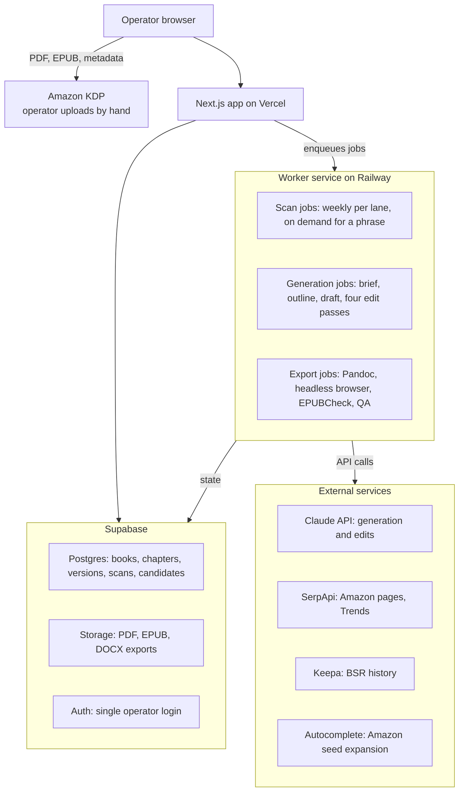

# Manuscript Engine: Product Specification

Version 1.0 · November 8, 2026 · Owner: Michael Wilson, Power Reads Publishing

## Overview

Manuscript Engine is a single-user web app that finds a book topic worth writing, then carries it from brief to publish-ready files for Amazon KDP. It is built for one operator running a high-volume nonfiction catalog, not for outside users.

Input is a lane (or all lanes), a voice profile, and approval at each stage. Output per book is a 6 x 9 print PDF with KDP-compliant margins, an EPUB for Kindle, and a metadata sheet with title, subtitle, description, seven keywords, two categories, and back cover copy.

The app runs eight stages in order. Stage 0 scans Amazon and Google Trends for high-demand, low-competition topics tied to real pain points. Stages 1 through 7 take an approved topic through brief, outline, draft, four edit passes, front and back matter, export, and QA.

The prompt layer encodes the existing seven-stage production SOP and the AI-Assisted Nonfiction Publishing System v2. The app is the operating surface for that system, not a replacement for it.

## Goals and non-goals

The app succeeds if one operator can take a book from topic selection to upload-ready files in under five working days with no outside editor.

**Goals**

- Surface topics with proven buyer demand, weak competition, and active pain-point search before any writing starts
- Produce a complete manuscript that holds voice, continuity, and the approved outline across every chapter
- Run developmental, line, copy, and proof editing automatically with a visible change log
- Export KDP-compliant 6 x 9 print PDF and EPUB plus full listing metadata in one click
- Keep every version so any chapter or pass can be rolled back
- Support multiple author identities (Michael, Cristina, pen names) through stored voice profiles
- Run Spanish editions as a language setting, not a separate workflow

**Non-goals**

- No multi-tenant accounts, billing, or marketing site
- No cover design; covers stay in the existing cover workflow and are attached at upload
- No puzzle or low-content books; this app is for full-text nonfiction only
- No direct publishing to KDP; the operator uploads the exported files by hand
- No fiction

## Stage 0: Market Scan

Stage 0 produces a ranked list of topic opportunities per lane, each with an Opportunity Score, the evidence behind it, and a Start Book action that pre-fills the Stage 1 brief. It runs on a weekly schedule per lane and on demand for a single seed phrase.

**Pass one: Amazon demand and supply**

1. Seed expansion. Take the lane's seed phrases and expand each through Amazon search autocomplete, appending letters a through z and a modifier list (for seniors, for beginners, workbook, large print, journal, guide, step by step, in Spanish). Keep every suggestion Amazon returns. Autocomplete presence is the strongest free demand signal available.
2. Results capture. For each candidate phrase, pull page one of Kindle and paperback results through a scraping vendor: total result count, and for each title the ASIN, title, BSR, review count, star rating, page count, price, publisher, and publication date.
3. Sales history. For the top ten ASINs per phrase, pull 90-day and 12-month BSR history from Keepa. A title that has held rank for a year is real demand; a launch spike is not.
4. Optional import. Accept Publisher Rocket or KDSpy CSV exports and merge them as a fifth source.

**Pass two: pain-point validation through Google Trends**

1. Pain translation. For each candidate phrase, Claude generates five to eight pain queries in the words a reader would type into Google, not book-buying language. Example: "sleep book for seniors" becomes "can't sleep after 60," "waking up at 3am every night," "how to fall back asleep," "melatonin not working."
2. Trends pull. For each pain query, fetch five-year interest over time, rising related queries, top related queries, and regional interest, plus a comparison against two sibling topics so scores are relative.
3. Vocabulary capture. Store rising and top related queries against the candidate. These feed titles, subtitles, and KDP keywords in Stage 1 and Stage 6.

**Scoring**

Four sub-scores, each normalized 0 to 100 within the lane.

| Sub-score | Inputs | Direction |
| --- | --- | --- |
| Demand | Median estimated monthly sales of top ten (from BSR); autocomplete presence bonus; 12-month BSR stability | Higher is better |
| Competition | Total results for exact phrase; mean review count of top ten; count of top ten from traditional publishers or established brands | Lower is better |
| Quality Gap | Share of top ten rated under 4.2 with steady sales; share older than three years; mean page count under 120; thin descriptions | Higher is better |
| Pain Signal | Mean five-year Trends interest weighted to last 12 months; 24-month slope; share of related queries with solution intent (how to, fix, stop, help, get rid of, what to do) | Higher is better |

Opportunity Score = (Demand x Quality Gap x Pain Signal) / Competition, rescaled 0 to 100 within the lane. All four inputs show beside the total so the operator can override.

**Quadrant view**

Each lane renders a 2 x 2 of Amazon Demand against Pain Signal.

| Quadrant | Reading | Action |
| --- | --- | --- |
| High demand, high pain | Proven market with active searchers | Write to the quality gap |
| Low demand, high pain | Underserved problem, no good book yet | Best chance to own the category early |
| High demand, low pain | Crowded shelf, fading interest | Skip unless a sharp angle exists |
| Low demand, low pain | No market | Ignore |

**Operator controls**

- Watchlist: phrases kept for re-scoring each week without starting a book
- Change alerts: flag any phrase where the top ten shifted by three or more titles since the last scan
- Lane defaults: seed phrases, modifier list, and language per lane, editable in Settings
- Start Book: creates the book record, sets lane and language, and drafts the Stage 1 brief with the quality gap as the book promise and the rising queries as candidate vocabulary

## Stage 1: Brief

The brief locks what the book is before anything is written. It is the reference every later stage checks itself against.

**Inputs**

- Working title and seed description (pre-filled from Stage 0 when started there)
- Lane and language (English or Spanish)
- Author identity and its voice profile
- Target word count (default 25,000 for a standard lane title; configurable per lane)
- Trim size (default 6 x 9), ebook on or off

**Generated fields, each editable before approval**

- Final title and subtitle, written in the reader's search vocabulary from Stage 0 rising queries
- Book promise: one paragraph stating the transformation the reader gets
- Reader profile: who they are, what they have tried, what they fear, what they want by the last page
- Positioning note: what the top five competing titles miss and how this book fills it
- Three to five core frameworks or named ideas the book will teach
- Tone and reading level target

**Rules**

The brief is locked on approval. Any later change reopens it and flags every downstream chapter for a drift check. The app blocks Stage 2 until the brief is approved.

## Stage 2: Outline

The outline is the chapter map, and nothing is drafted outside it.

**Generated structure**

- Introduction with a stated promise and a reason to keep reading
- Eight to fourteen chapters, each with: title, one-sentence chapter goal, three to five key points, the example or story to use, the action step the reader takes, and a word target
- Conclusion that restates the transformation and points to the Companion Course
- Suggested placement of frameworks from the brief so each is introduced once and used again later

**Operator actions**

- Reorder chapters by drag
- Merge, split, add, or delete chapters
- Rewrite any field in place or regenerate one chapter's entry with a note
- Rebalance word targets to hit the total from the brief

**Checks before approval**

- Every brief framework appears in at least one chapter
- No two chapters share more than one key point
- Word targets sum to within 10 percent of the brief total
- Each chapter has an example and an action step

The outline is locked on approval and Stage 3 opens.

## Stage 3: Draft

Chapters generate one at a time, in order, each carrying the full context it needs to stay consistent with the book around it.

**Context sent with every chapter call**

- The approved brief
- The approved outline, with the current chapter marked
- The voice profile
- A running summary of all prior chapters (regenerated after each chapter completes, capped at 1,500 words)
- The list of frameworks already introduced, so terms are used, not re-explained
- The chapter's word target with a tolerance of plus or minus 10 percent

**Operator actions**

- Generate next chapter, or generate all remaining chapters as a background job with progress shown per chapter
- Regenerate one chapter with a direction note ("shorter opening, more practical, add a second example")
- Edit any chapter directly in a rich text editor; manual edits are saved as a version like any regeneration
- Pin a chapter so batch operations skip it

**Rules**

- Every generation creates a new version; nothing is overwritten
- A chapter that lands outside the word tolerance is flagged, not rejected
- Chapters cannot be generated out of order on first pass; regeneration of any chapter is allowed at any time
- Stage 4 opens when every chapter has at least one version

## Stage 4: Edit passes

Four automatic passes run in fixed order over the whole manuscript, each producing a new version and a change log. The voice profile is enforced on every pass, and no pass may introduce vocabulary the profile prohibits.

| Pass | Scope | What it fixes | Log shows |
| --- | --- | --- | --- |
| Developmental | Whole book, chapter by chapter against the outline | Drift from chapter goal, missing steps, overlap between chapters, frameworks used before introduced, weak or missing examples and action steps | Per chapter: issues found, what changed, what was left for the operator |
| Line | Paragraph level | Flow, transitions, repetition, sentence rhythm, passive constructions, filler, paragraph length | Side-by-side diff per paragraph changed |
| Copy | Sentence level | Grammar, punctuation, capitalization, number style, consistent term usage, heading format | Count by category plus a diff |
| Proof | Final read | Typos, doubled words, spacing, stray formatting, cross-reference accuracy | Line-level list of corrections |

**Operator controls**

- Run all four passes as one job, or run one pass at a time
- Accept all, or review the change log and revert individual changes
- Set pass intensity per book: light, standard, or deep
- Mark a chapter as final so later passes skip it

**Rules**

- Passes never rewrite an example, story, or framework name; they flag it for the operator instead
- A pass that would change more than 40 percent of a chapter's text stops and asks before applying
- Stage 5 opens when all four passes have completed at least once

## Stage 5: Front and back matter

Every book ships with the same set of pages, generated from templates in Settings and the book record, so nothing is hand-assembled at upload.

**Front matter, in order**

1. Half title page
2. Title page with title, subtitle, author name, and imprint line
3. Copyright page from the imprint template, with year, author or pen name, ISBN if entered, and disclaimer text per lane (health lanes carry a medical disclaimer)
4. Dedication (optional)
5. Table of contents, generated from the final chapter headings
6. Introduction, drafted in Stage 3 and edited in Stage 4

**Back matter, in order**

1. Conclusion from the outline
2. Companion Course page: headline, three bullets on what the reader gets, the course URL, and a QR code generated from it
3. Also By page listing other titles under the same author identity, pulled from the catalog list
4. About the Author from the voice profile's bio field
5. Review request page with a short ask and the Amazon review link placeholder

**Rules**

- Print and ebook use the same content; the ebook drops the half title and the QR code becomes a live link
- Spanish editions pull Spanish templates for every fixed page
- The operator can hide any optional page per book

## Stage 6: Export

One Export action produces three files and stores them against the book with a version stamp.

**Print PDF (6 x 9)**

- Built from HTML with CSS paged media rendered by a headless browser, or from a Pandoc to LaTeX pipeline; the build chooses one in Phase 3 and both must pass the QA checks
- Body font Garamond 11 point with 1.15 line spacing unless the lane default overrides; chapter openers start on a right-hand page
- Margins set by the final page count using KDP's bands for no-bleed interiors: inside (gutter) 0.375 inch for 24 to 150 pages, 0.5 inch for 151 to 300, 0.625 inch for 301 to 500; outside, top, and bottom 0.5 inch
- Running heads with book title verso and chapter title recto; folios bottom center; no running heads or folios on display pages
- Fonts embedded, PDF/X-1a where the renderer supports it, otherwise standard PDF with all fonts embedded

**EPUB (Kindle)**

- EPUB 3 built from the same source with a generated navigation document, cover image slot, and semantic headings
- Reflowable, no fixed fonts, images under 5 MB total
- Passes EPUBCheck before the file is offered for download

**Metadata sheet**

One page, copy-ready for the KDP form:

- Title and subtitle
- Author identity
- Description under 4,000 characters, formatted with the HTML KDP accepts
- Seven keyword phrases, drawn from Stage 0 rising queries and autocomplete results, each under 50 characters
- Two categories suggested from the top ten competitors' categories
- Back cover copy at 150 to 200 words
- Price suggestions for print and ebook based on the top ten's median
- Companion Course URL and the Also By list

**Also produced**

- DOCX master of the full manuscript for any outside edit or archive
- Word count, page count, and spine width (page count x 0.002252 inch for white paper) for the cover designer

## Stage 7: QA checks

QA runs automatically before export and blocks the download on any hard failure. Soft warnings show but do not block.

| Check | Rule | Severity |
| --- | --- | --- |
| Word count | Within 10 percent of brief total | Soft |
| Page count band | Margins match the final page count band | Hard |
| Orphan headings | No heading within three lines of a page bottom | Hard |
| Widows and orphans | No single line of a paragraph alone at top or bottom of a page | Soft |
| Heading consistency | Every chapter heading uses the same style and numbering | Hard |
| Framework coverage | Every brief framework appears in the final text | Soft |
| Prohibited vocabulary | No terms from the voice profile's banned list | Hard |
| Em dashes | Zero in the final text | Hard |
| Front and back matter | Every required page present and in order | Hard |
| Companion Course link | URL resolves | Hard |
| EPUBCheck | Zero errors | Hard |
| Fonts embedded | All fonts embedded in the PDF | Hard |
| Image resolution | 300 dpi at placed size for print | Hard |
| Metadata lengths | Description under 4,000 characters; each keyword under 50 | Hard |

A passing QA run stamps the export as release-ready and records the check results with the version.

## Screens and navigation

Five screens cover the whole app. Navigation is a left sidebar with Library, Market Scan, Voice Profiles, and Settings; a book opens into its own workspace.

| Screen | Purpose | Main elements |
| --- | --- | --- |
| Library | Every book and its stage | Table of books with lane, author identity, stage, word count, last activity; filters by lane and stage; New Book button |
| Market Scan | Stage 0 results | Lane tabs; ranked candidate table with Opportunity Score and four sub-scores; quadrant chart; candidate detail drawer with top ten titles, BSR history, pain queries, rising queries; Watchlist; Start Book |
| Book Workspace | Stages 1 through 7 for one book | Left rail of stages with status; main panel for the current stage; right panel pinned to the brief, outline summary, and voice profile; version history drawer; job progress bar for long runs |
| Voice Profiles | Author identities | List of profiles; editor with bio, sample passages, rules, banned terms, preferred terms, test prompt that renders a sample paragraph |
| Settings | Defaults | Trim and typography per lane; copyright and disclaimer templates; Companion Course URL pattern; catalog list for Also By pages; lane seed phrases and modifiers; API keys and vendor status; scan schedule |

Every long operation (full draft, edit passes, export, market scan) runs as a background job with per-step progress and a notification on completion, so the operator can leave the screen.

## Voice profiles

A voice profile is the single source of truth for how an author identity sounds, and it is injected into every generation and edit call for that identity's books.

**Fields**

- Name and author identity type (real author or pen name)
- Bio for the About the Author page, in two lengths
- Voice rules: perspective (first or second person), sentence length range, paragraph length, formality, humor allowed or not, use of lists versus prose
- Preferred terms and phrases
- Banned terms and constructions (em dashes, emojis, and a lane-specific list)
- Three to five sample passages of 200 to 400 words that show the voice
- Signature moves: how chapters open, how action steps are framed, how the author handles examples
- Language: English, Spanish, or both

**Seed profiles**

Michael's Master Voice Prompt and Cristina's voice card load as the first two profiles. Pen-name profiles are created per lane and can be cloned from an existing profile and adjusted.

**Test**

Each profile has a Test action that renders a 300-word sample on a fixed topic so changes to the rules can be checked before they touch a book.

## Data model

All tables live in Supabase Postgres with row-level security tied to the single operator account. Files (PDF, EPUB, DOCX) live in Supabase Storage with paths recorded on the exports table.

| Table | Key fields | Notes |
| --- | --- | --- |
| books | id, title, subtitle, lane, language, author_identity_id, voice_profile_id, stage, target_words, trim, created_at | One row per book |
| briefs | book_id, promise, reader_profile, positioning, frameworks (json), tone, status, locked_at | One per book, versioned through versions table |
| outlines | book_id, chapters (json array), status, locked_at | Chapter order, goals, points, examples, word targets |
| chapters | id, book_id, position, title, current_version_id | Pointer to the live version |
| versions | id, chapter_id, content, source (draft, regen, manual, dev, line, copy, proof), note, word_count, created_at | Every change is a row; never overwritten |
| change_logs | id, book_id, pass, chapter_id, summary, diff (json), created_at | One per pass per chapter |
| voice_profiles | id, name, identity_type, bio_short, bio_long, rules (json), preferred_terms, banned_terms, samples (json), language | Shared across books |
| author_identities | id, display_name, voice_profile_id, also_by (json), review_link_pattern | Real authors and pen names |
| exports | id, book_id, version_stamp, pdf_path, epub_path, docx_path, metadata (json), qa_results (json), page_count, spine_width, created_at | One per export run |
| scans | id, lane, started_at, completed_at, status, source_counts (json) | One per scheduled or manual scan |
| candidates | id, scan_id, lane, phrase, demand, competition, quality_gap, pain_signal, opportunity_score, quadrant, status (new, watchlist, started, dismissed) | Ranked topic opportunities |
| competitor_snapshots | id, candidate_id, asin, title, bsr, reviews, rating, pages, price, publisher, pub_date, bsr_history (json), captured_at | Top ten per candidate per scan |
| pain_queries | id, candidate_id, query, interest_series (json), slope_24m, solution_intent_share, rising_related (json), top_related (json), regions (json) | Trends data per pain query |
| watchlist | id, candidate_id, added_at, last_score, score_delta | Phrases tracked across scans |
| jobs | id, type, book_id or scan_id, status, progress (json), error, started_at, finished_at | Background job tracking |
| settings | key, value (json) | Lane defaults, templates, schedules, vendor keys |

## Architecture and tech stack

The operator works only in the app; the worker runs every long job and every vendor call; Supabase holds state and files between them. The app never calls a vendor directly, so keys stay server-side and a slow scan or export never blocks the screen.

| Layer | Choice | Reason |
| --- | --- | --- |
| Front end and API routes | Next.js 15, TypeScript, Tailwind | One codebase, fast to build with Claude Code, free hosting on Vercel |
| Database, storage, auth | Supabase | Already in use; Postgres, file storage, and row-level security in one place |
| Background worker | Node service in a Docker container on Railway or Render | Needs Pandoc, a headless browser, and EPUBCheck, which serverless cannot run; owns the scan scheduler |
| Job queue | Supabase table polled by the worker (pg-boss or a simple jobs table) | No extra vendor; progress written back to the same database the UI reads |
| Generation | Claude API through the Anthropic SDK | Sonnet by default, Opus where configured |
| Print rendering | HTML plus CSS paged media through a headless browser, or Pandoc to LaTeX | Chosen in Phase 3 after a side-by-side test |
| EPUB | Pandoc, validated with EPUBCheck | Standard, reliable, Kindle-accepted |
| Source control and deploy | GitHub, Vercel auto-deploy for the app, Railway auto-deploy for the worker | Matches the decision to make GitHub the source of truth |

## External data sources, vendors, and costs

Total recurring vendor cost at steady state is roughly $150 to $250 per month, dominated by Claude API usage. Figures are approximate and should be confirmed at signup.

| Vendor | Used for | Approximate cost | Notes |
| --- | --- | --- | --- |
| Claude API (Anthropic) | All generation, editing, pain translation, metadata | $60 to $150 per month at 4 to 8 books per month | Sonnet for drafting and passes; Opus for brief and developmental pass if quality warrants |
| SerpApi | Amazon search results and Google Trends endpoints | About $50 per month at the weekly scan volume | One vendor covers both scan passes; stable against Google and Amazon changes |
| Keepa API | BSR history per ASIN | About $20 per month | Needed for the 12-month stability input |
| Amazon autocomplete | Seed expansion | Free | Public endpoint; rate limit politely |
| Supabase | Postgres, Storage, Auth | Free tier to $25 per month | Already in use |
| Vercel | Next.js hosting | Free tier to $20 per month | App only |
| Railway or Render | Worker service (Pandoc, headless browser, scheduled scans) | $7 to $20 per month | Needs a container, not serverless |
| EPUBCheck | EPUB validation | Free | Runs inside the worker |
| Publisher Rocket or KDSpy | Optional CSV imports | One-time or existing license | Not required |

All vendor keys are stored in Settings, encrypted at rest, and never sent to the browser.

## Prompt layer design

The prompt layer is a set of versioned templates stored in the repo, not in the database, so every change is reviewed and every book records which prompt version produced it.

**Structure**

- One system prompt per task: brief, outline, chapter draft, running summary, each of the four edit passes, pain translation, metadata, back cover copy, and keyword selection
- Each template has fixed slots for the brief, outline, voice profile, prior-chapter summary, and task-specific instructions
- Output is requested as structured JSON where the app needs fields (brief, outline, metadata, change logs) and as plain Markdown where the output is prose (chapters)
- Every call records model, prompt version, token counts, and latency on the jobs table

**Source**

The seven-stage production SOP and the AI-Assisted Nonfiction Publishing System v2 are the source of the task instructions. Phase 1 translates those documents into templates with no new rules added. Changes are made only after a real book shows a gap.

**Quality rules baked into every template**

- No em dashes, no emojis, paragraph default
- No generic motivational language; every claim ties to an action or an example
- Frameworks are named once and then used by name
- Chapter openers vary; no two consecutive chapters open the same way
- Edit passes return a change log in the same call as the edited text

**Evaluation**

A fixed test book (brief plus outline) runs after any template change. The operator reads the first two chapters and the developmental log before the change ships.

## Build plan by phase

Four phases over roughly four weeks, each ending with a real book or a real scan the operator can judge. Phase 0 runs before any UI is written.

| Phase | Duration | Deliverable | Exit test |
| --- | --- | --- | --- |
| 0: Prompt pipeline | 3 to 4 days | The SOP and Publishing System v2 encoded as prompt templates and run as a Claude Code script: brief, outline, draft, four passes, DOCX out | Two complete manuscripts produced and read; template gaps fixed |
| 1: Core app | Week 1 | Next.js app on Vercel, Supabase schema, auth, Library, Book Workspace for Stages 1 to 4 with versions and change logs, DOCX export, background jobs | One book carried through Stage 4 in the UI; every chapter has rollback |
| 2: Market Scan | Week 2 | Worker service with scheduled scans; autocomplete expansion; SerpApi Amazon and Trends pulls; pain translation; scoring; candidate table, quadrant chart, watchlist, Start Book | One lane scanned end to end; top ten candidates hand-checked against Amazon and Trends; formula adjusted |
| 3: Export and QA | Week 3 | Voice Profiles screen; Stage 5 templates; print PDF and EPUB renderers; metadata sheet; all QA checks; Keepa BSR history; Settings | One book exported, uploaded to KDP as a draft, and passing KDP's previewer with no margin or font errors |
| 4: Harden | Week 4 | Spanish templates and language switch; change alerts; prompt evaluation harness; error handling and retries; backups | Three books in flight at once with no manual intervention between stages |

Phase 0 is the gate. If the prompt pipeline cannot produce a manuscript the operator would publish, the app is not built until it can.

## Risks and guardrails

The largest risks sit in data access and manuscript quality, not in the app code.

| Risk | Impact | Guardrail |
| --- | --- | --- |
| Amazon blocks or changes results pages | Scan pass one stops | Use a scraping vendor so the risk is theirs; cache results; keep the Publisher Rocket CSV import as a fallback; never scrape from the publishing network or account |
| Google Trends changes or rate-limits | Pain Signal stops updating | Vendor endpoint instead of pytrends; store series locally so trajectory still computes from history |
| BSR-to-sales estimates drift | Demand score misleads | Show raw BSR beside the estimate; recalibrate quarterly against known titles |
| Voice drift across chapters | Manuscript reads as assembled, not written | Running summary and voice profile on every call; developmental pass checks continuity; operator reads chapters 1, middle, and last before passes |
| Edit passes flatten voice | Generic output | Passes may not rewrite examples or framework names; 40 percent change cap; banned term list enforced |
| KDP rejects the PDF | Delayed launch | Margin bands computed from final page count; fonts embedded; QA hard failures block export; Phase 3 exit test is a KDP previewer pass |
| Factual errors in health or money lanes | Reader harm, reviews, account risk | Lane disclaimers on the copyright page; developmental pass flags unsupported claims; operator reviews flagged claims before Stage 5 |
| Over-reliance on one model vendor | Outage stops production | Model name is a setting; templates avoid vendor-specific syntax |
| Scraping terms of service | Account exposure | Third-party vendors only; separate credentials and network from KDP; no stored Amazon customer data |
| Cost creep on API usage | Margin erosion | Token budget per book shown in the workspace; Sonnet by default; Opus only where set |

## Open decisions

- [ ] Confirm Garamond 11 point with 1.15 spacing as the default body setting, or name an alternative per lane
- [ ] Phase 0 prompt source: translate the Publishing System v2 as written, or rebuild the task instructions from a fresh spec
- [ ] Default word count per lane (25,000 proposed as the standard; confirm for Faith and Devotional and Brain Health)
- [ ] Print renderer: CSS paged media through a headless browser, or Pandoc to LaTeX; decide after a side-by-side test in Phase 3
- [ ] Which pen names exist today per lane, so voice profiles can be seeded in Phase 3
- [ ] Companion Course URL pattern per book, so the back matter template and QR code can be generated
- [ ] Whether to add IngramSpark export (5.5 x 8.5 and 6 x 9 with bleed) in a later phase
- [ ] Scan cadence: weekly per lane as proposed, or daily for the two highest-priority lanes
